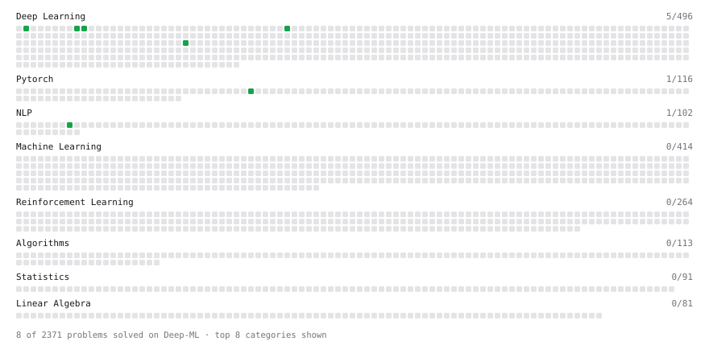

# Deep-ML

My machine learning practice from [Deep-ML](https://www.deep-ml.com). Every solution here was written by hand.

**20** solved · 12 problems · 0 labs · 8 math

[**Browse the interactive portfolio**](https://nATINDERdEEP.github.io/deep-ml/) to replay this filling in over time.

## Problems

| | Difficulty | Solved | |
| --- | --- | --- | --- |
| [Add a Bias Vector to a Batch via Broadcasting](https://www.deep-ml.com/problems/882) | easy | 2026-11-23 | [solution](problems/0882-add-a-bias-vector-to-a-batch-via-broadcasting) |
| [Calculate Perplexity for Language Models](https://www.deep-ml.com/problems/320) | easy | 2026-10-07 | [solution](problems/0320-calculate-perplexity-for-language-models) |
| [Compute Multi-class Cross-Entropy Loss](https://www.deep-ml.com/problems/134) | easy | 2026-10-07 | [solution](problems/0134-compute-multi-class-cross-entropy-loss) |
| [Create a Float Tensor from a Python List](https://www.deep-ml.com/problems/880) | easy | 2026-11-23 | [solution](problems/0880-create-a-float-tensor-from-a-python-list) |
| [Create and Inspect a Tensor](https://www.deep-ml.com/problems/1220) | easy | 2026-11-23 | [solution](problems/1220-create-and-inspect-a-tensor) |
| [Implement ReLU Activation Function](https://www.deep-ml.com/problems/42) | easy | 2026-11-22 | [solution](problems/0042-implement-relu-activation-function) |
| [Leaky ReLU Activation Function](https://www.deep-ml.com/problems/44) | easy | 2026-11-22 | [solution](problems/0044-leaky-relu-activation-function) |
| [Reshape and Transpose a Tensor](https://www.deep-ml.com/problems/1221) | easy | 2026-11-23 | [solution](problems/1221-reshape-and-transpose-a-tensor) |
| [Reshape and Transpose a Tensor](https://www.deep-ml.com/problems/881) | easy | 2026-11-23 | [solution](problems/0881-reshape-and-transpose-a-tensor) |
| [Simple Self-Attention Without Trainable Weights](https://www.deep-ml.com/problems/955) | easy | 2026-10-07 | [solution](problems/0955-simple-self-attention-without-trainable-weights) |
| [Softmax Activation Function Implementation ](https://www.deep-ml.com/problems/23) | easy | 2026-09-16 | [solution](problems/0023-softmax-activation-function-implementation) |
| [Entropy & Cross-Entropy](https://www.deep-ml.com/problems/205) | medium | 2026-10-07 | [solution](problems/0205-entropy-cross-entropy) |

## Math

| | Difficulty | Solved | |
| --- | --- | --- | --- |
| [Derivatives and Gradients](https://www.deep-ml.com/math-problems/1) | easy | 2026-10-07 | [solution](math/0001-derivatives-and-gradients) |
| [Gradient Descent Updates](https://www.deep-ml.com/math-problems/5) | easy | 2026-10-07 | [solution](math/0005-gradient-descent-updates) |
| [PagedAttention Internal Fragmentation](https://www.deep-ml.com/math-problems/67) | easy | 2026-11-20 | [solution](math/0067-pagedattention-internal-fragmentation) |
| [What the Bias Term Buys: Affine Maps, the Bias Gradient and When It Is Redundant](https://www.deep-ml.com/math-problems/277) | easy | 2026-11-22 | [solution](math/0277-what-the-bias-term-buys-affine-maps-the-bias-gradient-and-when-it-is-redundant) |
| [Information Theory: Entropy](https://www.deep-ml.com/math-problems/24) | medium | 2026-09-16 | [solution](math/0024-information-theory-entropy) |
| [Log-Likelihood Gradients](https://www.deep-ml.com/math-problems/38) | medium | 2026-09-16 | [solution](math/0038-log-likelihood-gradients) |
| [Softmax and Cross-Entropy](https://www.deep-ml.com/math-problems/32) | medium | 2026-09-16 | [solution](math/0032-softmax-and-cross-entropy) |
| [Statistical Inference](https://www.deep-ml.com/math-problems/27) | medium | 2026-11-21 | [solution](math/0027-statistical-inference) |

---

_This file is regenerated by Deep-ML on every push._
